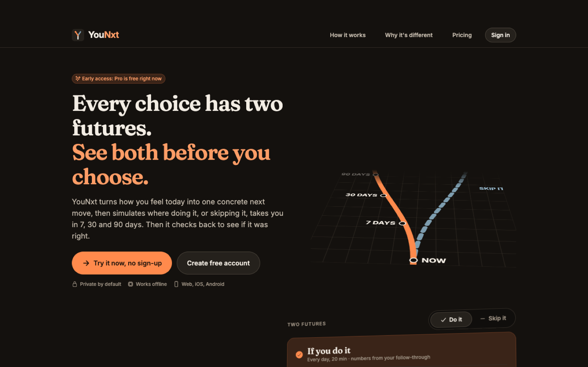
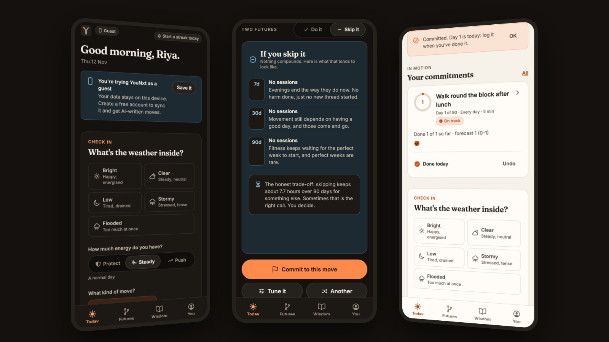
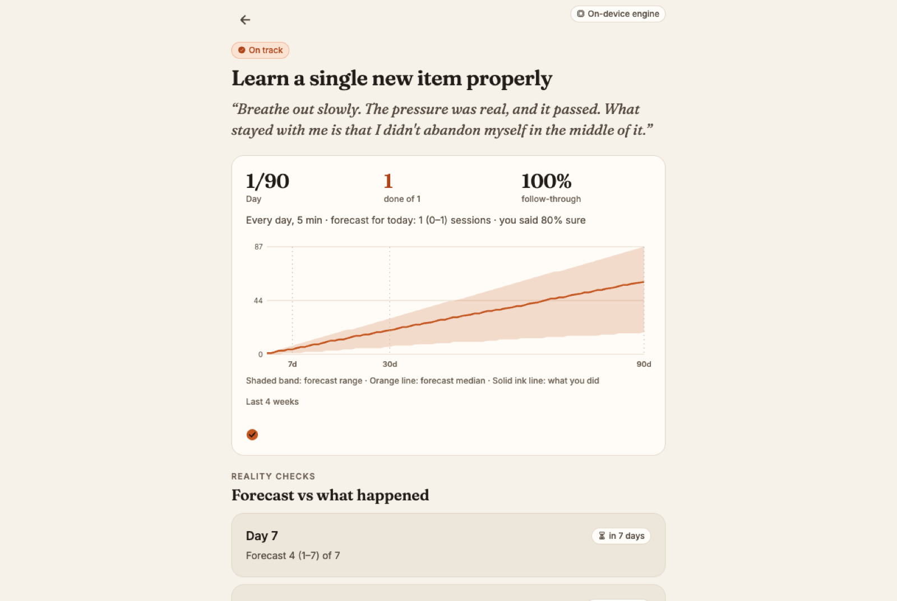
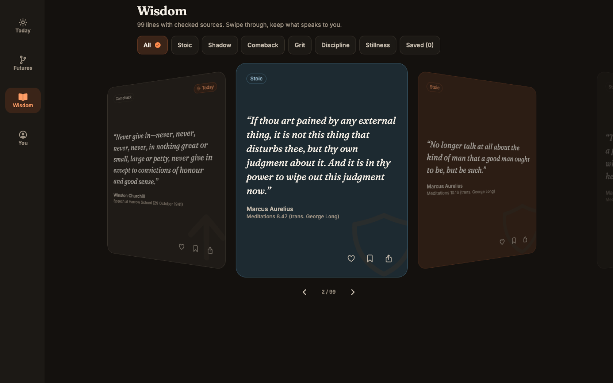

  

<h1 align="center">YouNxt</h1>

  <b>See both futures before you choose.</b> 
  One concrete next move. A forecast built from your own follow-through. Reality checks at 7, 30 and 90 days.

  <a href="https://anshumaansinghh.github.io/younxt/"><b>Try it live →</b></a>
  &nbsp;·&nbsp; no sign-up needed &nbsp;·&nbsp; web, iOS and Android

---

## What it does

1. **Check in.** Tell it your inner weather (bright, clear, low, stormy, flooded) and how much energy you really have. Ten seconds.
2. **Get one move.** Not a list of ten habits: one concrete thing you can do today, with three steps and a reason it fits you right now.
3. **See two futures.** Flip the card between *do it* and *skip it* at 7, 30 and 90 days. The "do it" side shows a forecast range, not a promise.
4. **Commit, log, reality-check.** One tap a day to log. On day 7, 30 and 90 YouNxt compares what it forecast with what you actually did.

## Why it's different

Most AI self-improvement apps write a confident plan and never look back. YouNxt is built to be **honest you can check**:

| A typical AI coach | YouNxt |
|---|---|
| Prints a made-up "confidence score" | Shows a range from a simulation of **your own** logged follow-through |
| Never checks whether it was right | **Reality checks** at day 7, 30 and 90, forecast vs actual |
| Same advice for everyone | The forecast learns from every session you log, done or skipped |
| Needs an account first | Every feature works as a guest, even offline |

It also tells you something nothing else does: **how well you predict yourself.** Each commitment asks how sure you are; weeks later you see the gap ("you say 90%, you deliver 62%").

## Features

- **The Future Engine.** A Monte Carlo simulation (hundreds of possible next-90-days) driven by a Bayesian model of your follow-through, with momentum from streaks and drag from missed days. The numbers come from the model, never from an AI.
- **AI-written moves** for signed-in users, generated server-side (no keys in your browser), plus an on-device library of 95 hand-written moves so it always works.
- **Two-futures flip card**, reality checks and calibration.
- **Letters to future you.** Seal a letter for a week, a month, 90 days or a year. It opens on the day, next to what you did in between.
- **Wisdom.** 99 quotes, each traced to its real source (many popular "Stoic" quotes are misattributed; these aren't), in a 3D cover-flow.
- **Day and Night themes** with every text colour checked against WCAG contrast; status never shown by colour alone.
- **Private by default.** Guest data stays on your device. Account data is readable only by you. Export or delete everything any time.
- **Safety first.** If what you type suggests you might be in danger, YouNxt stops coaching and shows crisis lines instead.

## Plans

| | Free | Pro |
|---|---|---|
| Check-ins and next moves | ✓ (on-device; 5 AI moves a day with an account) | 60 AI moves a day |
| Two-futures forecast | 7 and 30 days | 7, 30 and 90 days |
| Active commitments | 2 | 12 |
| Calibration report | Basic | Full |
| Letters to future you | 1 sealed | Unlimited |

**Early access:** every Pro feature is free right now. Join the founding list in the app to lock in lifetime Pro at the founding price when payments open.

## Built with

Expo + React Native (one codebase for web, iOS and Android) · Expo Router · Reanimated 3D motion · react-native-svg charts · Firebase Auth, Firestore and Cloud Functions · Gemini and Groq behind a server-side gateway · Lemon Squeezy for billing.

## Source code

YouNxt v2 is a commercial product and its source is private. This repository is the public home for the project: screenshots, the changelog, and the **issue tracker for feedback, bugs and feature requests**.

Version 1 (April 2026) was published here under the MIT licence and is still available in this repository's history under those terms.

## Feedback

[Open an issue](https://github.com/AnshumaanSinghh/younxt/issues/new/choose) or email singhanshumaan9169@gmail.com.

© 2026 Anshumaan Singh · YouNxt

